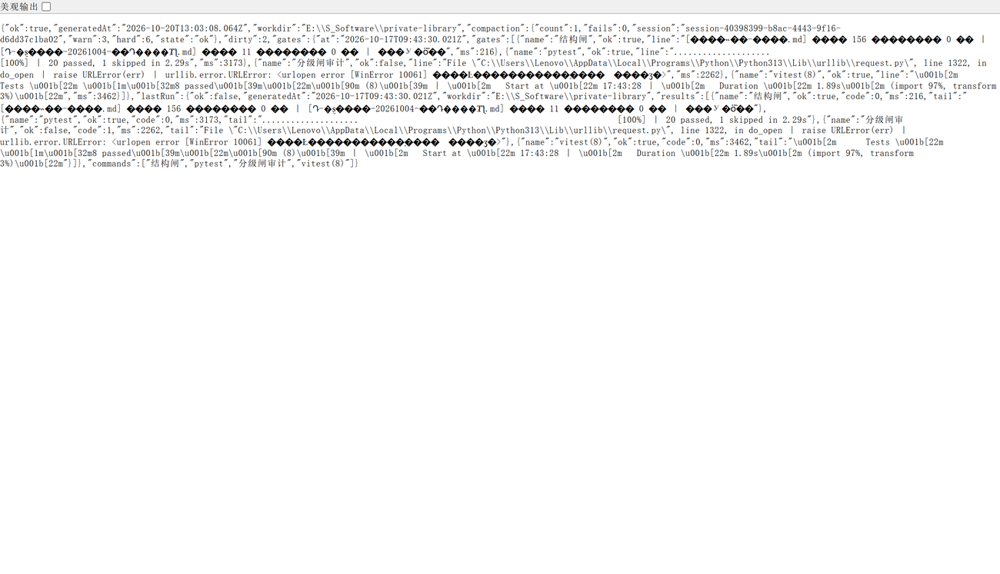

# dsh-pulse

> 名字从 `dsh-discipline` 改为 `dsh-pulse`（2026-10-20）：数据目录**仍是** `~/.dsh/discipline/`
> （配置与闸缓存都在里面，改路径等于把它们丢掉）。


把本机纪律**固定成插件**：统计条上一格常驻读数 + 一次点击产出报告。


*真机截图：三格都在这条状态栏里 —— 压缩 1/6（判级数 / hard 阈值）、闸 3/4（四道机械闸过了 3 道）、
改动 2（未提交改动数）。点这一格会按配置跑命令集，下面那张是它自己的 
eport.json。*




> 2026-10-20 合并：原先「压缩次数」由 `dsh-compaction-meter` 算并落投影，本插件只是读它 ——
> 一个数跨两个插件。现在投影逻辑（`lib/compaction.js`）已并进来，**投影 key 仍是
> `compactionMeter`**（改名会让已有会话的累计数归零），`dsh-compaction-meter` 已停用。
> 一格三数（压缩 / 闸 / 改动）从此同源同版本。

## 它解决什么

纪律（压缩判级 / 四闸 / 未提交改动）原先散在脚本里，靠人记得跑 —— 靠自觉就是假闸。
这个插件把三件事钉进宿主：**看得见**（统计条一格）、**点得动**（一键跑配置里的命令集）、**有产出**（md + json 落盘）。

## 两条路由（裸路由，自过来源栅栏：只认 loopback、非同站跨域）

| 路由 | 作用 |
|---|---|
| `GET /dsh-pulse/report.json` | 现算轻量态：压缩判级（读 `~/.dsh/compaction-guard.json` 与投影缓存 `compactionMeter`）、闸缓存、未提交改动数、配置里的命令名 |
| `POST /dsh-pulse/run` | 按配置依次跑命令集，写 `last-report.json`、`gates.json`、`纪律报告-<时间戳>.md` |

## 配置 `~/.dsh/discipline/config.json`

```json
{
  "workdir": "E:\\S_Software\\private-library",
  "commands": [
    { "name": "结构闸", "cmd": "python docs\\probe-结构完整性.py", "timeoutMs": 300000 }
  ]
}
```

每个 `cmd` 用 `cmd /d /s /c` 在 `workdir` 里执行；`ok` 只看退出码，`tail` 留最后三行非空输出。
**写这个文件别用带 BOM 的编码**（PowerShell 5.1 的 `Set-Content -Encoding UTF8` 会带 BOM，
插件已剥 BOM 兜底，但别的读口不一定）。

## 安装 / 卸载

```bash
dsh plugin --profile web add "E:/S_Software/deepseek-harness/plugins/dsh-pulse"
dsh plugin --profile web remove dsh-pulse
```

- **宿主侧新增包可不重启激活**（实测：装完 `curl /dsh-pulse/report.json` 立刻 200）。
- 但**改已加载的 `lib/index.js` 不热更**（ESM 已 import），且**客户端那一格进 boot 图要重启 dsh web** ——
  所以「装完先看到读数、重启后看到那一格」是正常次序，不是没装上。

## 读数口径（写在明处，免得被误读）

- 宿主侧**不知道当前会话是哪条**（URL 里没有会话 id），压缩读数取「最近 6 小时内压缩最多的会话」当最坏值，
  并在 `report.json` 里附上 `newestSession` / `newestCount` 做对照。
- 投影形状：`rows.compactionMeter = {ver, seq, val:{compactions, compactionFailures, lastAt, lastFailureAt}}`
  （10-15 实读；**别遍历求和**，那会把 `ver/seq` 也加进去 —— 本插件第一版就这么得到 1664 的假红）。
- 只有退出码为 0 才算闸过；红了就是红了，插件不做"接近通过"的修辞。

## 视觉约束

浏览器半边只用宿主令牌（`--dsw-alias-*` / `--dsw-font-*`），**不写死颜色**：十六进制色值、
`rgb` 与 `hsl` 函数一个都不许出现（源码级闸；注意注释里写示例也会被判违规 —— 10-15 假红一次）。
